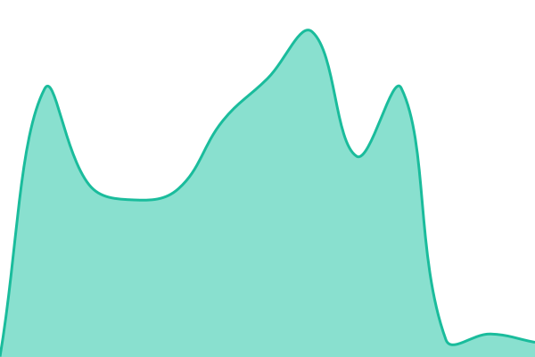
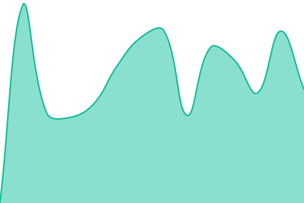

# [📈 Live Status](https://status.sudoo.sh): <!--live status--> **🟧 Partial outage**

This repository contains the open-source uptime monitor and status page for [Sudoo.sh](https://sudoo.sh), powered by [Upptime](https://github.com/upptime/upptime).

With [Upptime](https://upptime.js.org), you can get your own unlimited and free uptime monitor and status page, powered entirely by a GitHub repository. We use [Issues](https://github.com/Sudoo-sh/status-page/issues) as incident reports, [Actions](https://github.com/Sudoo-sh/status-page/actions) as uptime monitors, and [Pages](https://status.sudoo.sh) for the status page.

<!--start: status pages-->
<!-- This summary is generated by Upptime (https://github.com/upptime/upptime) -->
<!-- Do not edit this manually, your changes will be overwritten -->
<!-- prettier-ignore -->
| URL | Status | History | Response Time | Uptime |
| --- | ------ | ------- | ------------- | ------ |
|  [Hub API](https://hub.sudoo.sh/healthz) | 🟩 Up | [hub-api.yml](https://github.com/Sudoo-sh/status-page/commits/HEAD/history/hub-api.yml) | 

 597ms
     
 | 

<a href="https://status.sudoo.sh/history/hub-api">100.00%</a>
    

|  [Sign-in](https://auth.sudoo.sh/health) | 🟩 Up | [sign-in.yml](https://github.com/Sudoo-sh/status-page/commits/HEAD/history/sign-in.yml) | 

 685ms
     
 | 

<a href="https://status.sudoo.sh/history/sign-in">100.00%</a>
    

|  [Account](https://app.sudoo.sh/) | 🟩 Up | [account.yml](https://github.com/Sudoo-sh/status-page/commits/HEAD/history/account.yml) | 

 617ms
     
 | 

<a href="https://status.sudoo.sh/history/account">100.00%</a>
    

|  [Admin](https://admin.sudoo.sh/health) | 🟥 Down | [admin.yml](https://github.com/Sudoo-sh/status-page/commits/HEAD/history/admin.yml) | 

 528ms
     
 | 

<a href="https://status.sudoo.sh/history/admin">100.00%</a>
    

|  [Developers](https://developers.sudoo.sh/) | 🟩 Up | [developers.yml](https://github.com/Sudoo-sh/status-page/commits/HEAD/history/developers.yml) | 

 741ms
     
 | 

<a href="https://status.sudoo.sh/history/developers">100.00%</a>
    

|  [Marketplace](https://marketplace.sudoo.sh/) | 🟩 Up | [marketplace.yml](https://github.com/Sudoo-sh/status-page/commits/HEAD/history/marketplace.yml) | 

 782ms
     
 | 

<a href="https://status.sudoo.sh/history/marketplace">100.00%</a>
    

|  [Files](https://files.sudoo.sh/healthz) | 🟩 Up | [files.yml](https://github.com/Sudoo-sh/status-page/commits/HEAD/history/files.yml) | 

 569ms
     
 | 

<a href="https://status.sudoo.sh/history/files">100.00%</a>
    

|  [Website](https://sudoo.sh/) | 🟩 Up | [website.yml](https://github.com/Sudoo-sh/status-page/commits/HEAD/history/website.yml) | 

 147ms
     
 | 

<a href="https://status.sudoo.sh/history/website">100.00%</a>
    

|  [Docs](https://docs.sudoo.sh/) | 🟩 Up | [docs.yml](https://github.com/Sudoo-sh/status-page/commits/HEAD/history/docs.yml) | 

 213ms
     
 | 

<a href="https://status.sudoo.sh/history/docs">100.00%</a>
    

|  [Installer](https://get.sudoo.sh/) | 🟩 Up | [installer.yml](https://github.com/Sudoo-sh/status-page/commits/HEAD/history/installer.yml) | 

 548ms
     
 | 

<a href="https://status.sudoo.sh/history/installer">100.00%</a>
    

<!--end: status pages-->

[**Visit our status website →**](https://status.sudoo.sh)

## 📄 License

- Powered by: [Upptime](https://github.com/upptime/upptime)
- Code: [MIT](./LICENSE) © [Anand Chowdhary](https://anandchowdhary.com)
- Data in the `./history` directory: [Open Database License](https://opendatacommons.org/licenses/odbl/1-0/)
